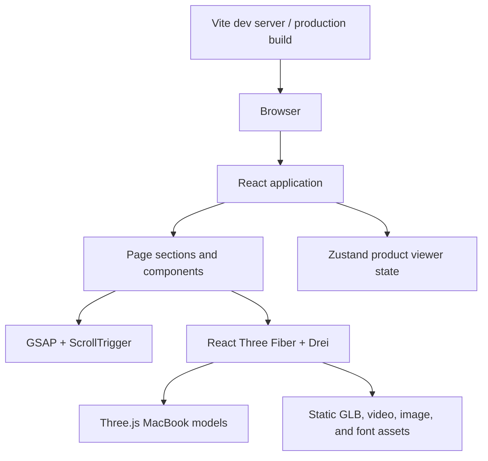

# MacBook Pro 3D Product Landing Page


A responsive product showcase featuring interactive 3D MacBook models, video, and scroll-driven animations.

## Table of Contents

- [Overview](#overview)
- [Features](#features)
- [Technology Stack](#technology-stack)
- [Architecture](#architecture)
- [Project Structure](#project-structure)
- [Installation and Setup](#installation-and-setup)
- [Environment Variables](#environment-variables)
- [Usage](#usage)
- [API](#api)
- [Database](#database)
- [Contributing](#contributing)
- [License](#license)

## Overview

This repository contains a single-page MacBook Pro product showcase built with React. It presents product imagery and copy alongside interactive 3D laptop models and video-driven sections.

The project is a visual product-presentation example and a starting point for developers exploring React, Three.js, and scroll-based animation. It is a frontend-only experience; it does not include a commerce backend or working purchase flow.

## Features

- **Interactive 3D product viewer** — View 14-inch and 16-inch MacBook models, change the displayed color, and rotate the models.
- **Scroll-driven product storytelling** — GSAP animations coordinate section transitions, 3D model motion, and feature callouts.
- **Video-backed feature section** — Feature videos are used as screen textures on the 3D model.
- **Responsive layouts** — Product and feature content adapt to smaller viewports.
- **Product showcase sections** — Includes hero, performance, highlights, and product-detail content.
- **Mobile navigation menu** — A toggleable menu is provided for smaller screens.

**Interaction note:** The Buy, search, and cart controls do not have implemented actions. Navigation and footer links are placeholders. AI-related text is presentation copy; the application does not connect to AI services.

## Technology Stack

| Category | Technologies |
|---|---|
| Frontend | React 19, Vite 8 |
| 3D rendering | Three.js, React Three Fiber, React Three Drei |
| Animation | GSAP, `@gsap/react`, ScrollTrigger |
| Styling | Tailwind CSS 4, `@tailwindcss/vite`, custom CSS |
| State | Zustand |
| Responsive behavior | `react-responsive` |
| Utilities | `clsx` |
| Development tools | Node.js, npm, ESLint |

There is no backend, database, authentication system, or AI integration in this project.

## Architecture

The browser loads the React application and its static assets. React components build the page, Zustand holds the product viewer’s selected color, size, and screen texture, and React Three Fiber renders the 3D models. GSAP and ScrollTrigger coordinate animations as the user scrolls.



## Project Structure

```text
.
├── index.html
├── package.json
├── package-lock.json
├── vite.config.js
├── eslint.config.js
├── public/
│   ├── fonts/
│   ├── models/
│   ├── videos/
│   └── product images and SVG icons
└── src/
    ├── App.jsx
    ├── App.css
    ├── index.css
    ├── main.jsx
    ├── components/
    │   ├── Features.jsx
    │   ├── Footer.jsx
    │   ├── Hero.jsx
    │   ├── Highlights.jsx
    │   ├── NavBar.jsx
    │   ├── Performance.jsx
    │   ├── ProductViewer.jsx
    │   ├── Showcase.jsx
    │   ├── models/
    │   └── three/
    ├── constants/
    └── store/
```

- `src/App.jsx` assembles the page sections.
- `src/components/` contains the page sections and 3D viewer components.
- `src/components/models/` contains React components for the laptop GLB models.
- `src/components/three/` contains shared 3D scene lighting and model-switching logic.
- `src/constants/` contains navigation, feature, and image data.
- `src/store/` contains Zustand state for the product viewer.
- `public/models/`, `public/videos/`, `public/fonts/`, and other files in `public/` contain assets served directly by Vite.

## Installation and Setup

### Prerequisites

- Node.js **20.19+**, **22.13+**, or **24+**, as required by the Vite version in the lockfile.
- npm.

### Clone and install

```bash
git clone https://github.com/Pruthvi5559/3D_Product_Landing_Page.git
cd 3D_Product_Landing_Page
npm ci
```

### Start the development server

```bash
npm run dev
```

Open the local URL printed by Vite in your terminal.

### Build and preview

```bash
npm run build
npm run preview
```

The production build is generated in `dist/`.

## Environment Variables

The application does not currently read environment variables. No `.env` configuration is required.

| Variable | Description | Required |
|---|---|---|
| — | No application environment variables are defined. | No |

## Usage

Run `npm run dev` and open the local Vite URL. Scroll through the page to view the animated product sections. In the 3D product viewer, use the controls to switch between the 14-inch and 16-inch models and select a color. Drag the model to rotate it.

The page is a visual showcase, not a complete shopping application. Purchase, search, cart, and placeholder navigation links do not perform actions.

## API

There is no backend API in this repository. The application loads its models, videos, and other static assets from `public/`.

## Database

No database or database schema is included.

## Contributing

Contributions are welcome.

1. Fork the repository.
2. Create a branch for your change.
3. Make and test your changes.
4. Commit with a clear message.
5. Open a pull request describing the change.

## License

This project is licensed under the Apache License, Version 2.0. See the [Apache License 2.0](https://www.apache.org/licenses/LICENSE-2.0) for the license terms.
